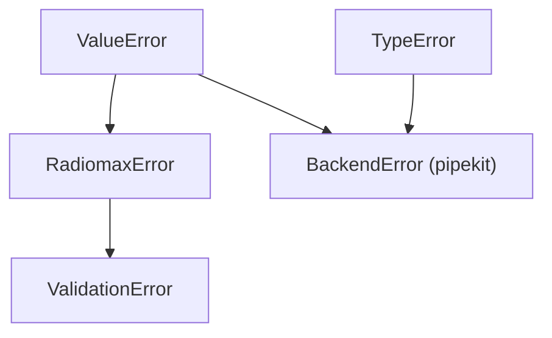

# Exceptions

Every error raised by the package derives from [`RadiomaxError`][radiomax.RadiomaxError], which is itself a `ValueError`.
The exception is the array backend, which is [pipekit-array's](https://jejjohnson.github.io/pipekit/reference/pipekit-array/#plain-functions): an array of an unknown library, or of several in one call, raises pipekit's `BackendError`, and an input that is not real, or an unlabelled array next to a labelled one, raises a plain `ValueError`.
Both are a `ValueError`.

::: radiomax.exceptions
